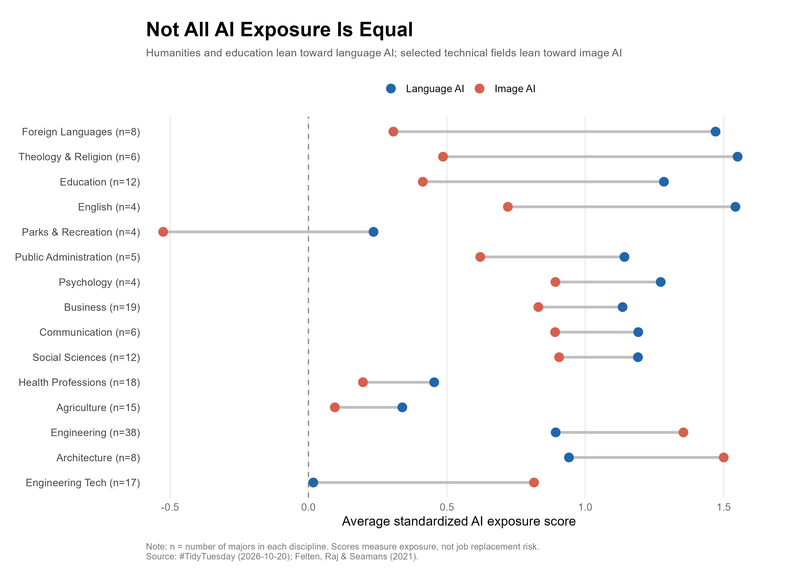
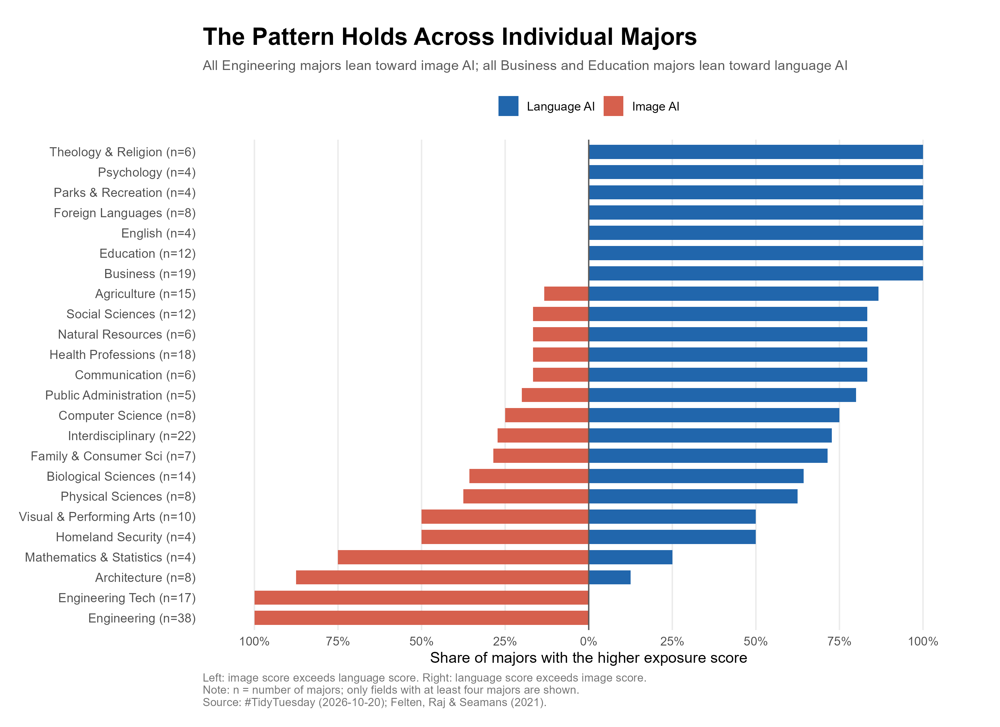

# Not All AI Exposure Is Equal

### Language and Image AI Exposure Across U.S. College Majors

A #TidyTuesday data visualization project exploring how language-related and image-related AI exposure differ across U.S. college majors.

**[View the interactive Quarto report](https://jatphat.github.io/TidyTuesday-AI-Exposure-2026/)**

## Research Questions

1. How does language-related versus image-related AI exposure differ across academic disciplines?
2. Do individual college majors within those disciplines follow the same exposure pattern?

## Key Findings

- All 38 Engineering majors and all 17 Engineering Technology majors have higher image-related than language-related AI exposure scores.
- All 19 Business majors and all 12 Education majors have higher language-related exposure scores.
- Other disciplines, including Computer Science, show more mixed patterns.

These results describe differences in standardized occupational AI exposure indices, not the probability of job displacement.

## Visualizations

### 1. Average AI Exposure Across Disciplines

### 2. Consistency of AI Exposure Across Majors

## Data and Methods

The analysis uses the October 20, 2026 TidyTuesday dataset, combining college earnings information from the U.S. Department of Education with occupational AI exposure measures based on Felten, Raj, and Seamans (2021).

The dataset contains 285 college majors and 1,505 major–occupation mappings.

Visualizations were created using R, `tidyverse`, `ggplot2`, and Quarto.

## Reproducibility

The complete R code and analysis are available in [Jehoshaphat_T_Abaya_TidyTuesday.qmd](Jehoshaphat_T_Abaya_TidyTuesday.qmd).

## Data Source

[TidyTuesday — October 20, 2026](https://github.com/rfordatascience/tidytuesday/tree/main/data/2026/2026-10-20)

---

**Author:** Jehoshaphat T. Abaya  
**Course:** PMAP 8551 — Data Visualization, Fall 2026  
**Tags:** #TidyTuesday #RStats #DataVisualization #ArtificialIntelligence
